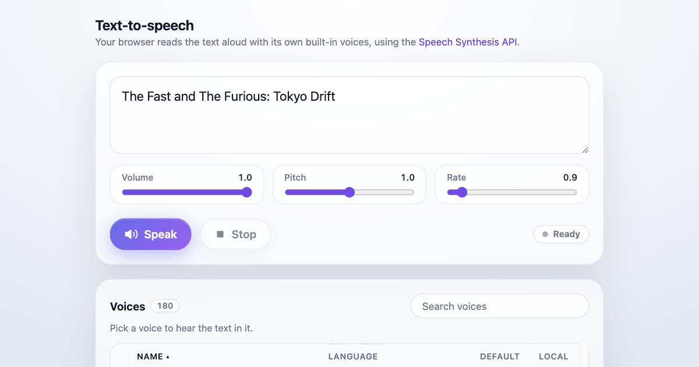

# text-to-speech

[](https://github.com/andrewmacheret/text-to-speech/actions/workflows/deploy.yml) [](https://github.com/andrewmacheret/text-to-speech/actions/workflows/canary.yml) [](https://github.com/andrewmacheret/text-to-speech/blob/master/LICENSE.md)

Text-to-speech in the browser using the [Speech Synthesis API](https://developer.mozilla.org/en-US/docs/Web/API/Web_Speech_API). Plain JavaScript, no libraries.

Type some text, set the volume, pitch and rate, and pick from your browser's built-in voices. The voice list can be searched and sorted. It uses the same glassy look as the [cube](https://andrewmacheret.com/projects/cube/), [Monty Hall](https://andrewmacheret.com/projects/montyhall/) and [NHL](https://andrewmacheret.com/projects/nhl/) pages, follows the system's light or dark mode, and works on phones and desktops.

See it running at [https://andrewmacheret.com/projects/text-to-speech/](https://andrewmacheret.com/projects/text-to-speech/).

<picture>
  <source media="(prefers-color-scheme: dark)" srcset="www/screenshot-dark.png">
  
</picture>

## Run it locally

```
cd www
python3 -m http.server
```

Then open [http://localhost:8000](http://localhost:8000) and click "Speak" (or press Cmd+Enter or Ctrl+Enter in the text box). You should hear the text. Picking a voice from the table also reads the text in that voice.

`www/screenshot.png` is used for this README and for link previews (`og:image`). `www/screenshot-dark.png` is the README screenshot for GitHub's dark theme.

## Health check

Once a day, the Canary workflow (`.github/workflows/canary.yml`) checks the page and its scripts and styles. It's started by [andrewmacheret/canary](https://github.com/andrewmacheret/canary).

## Deploy

Pushing to `master` runs [GitHub Actions](.github/workflows/deploy.yml), which syncs `www/` to `s3://andrewmacheret.com/projects/text-to-speech` and clears the CloudFront cache. It signs in to AWS with GitHub OIDC using the role in the `AWS_ROLE_ARN` repo variable.
